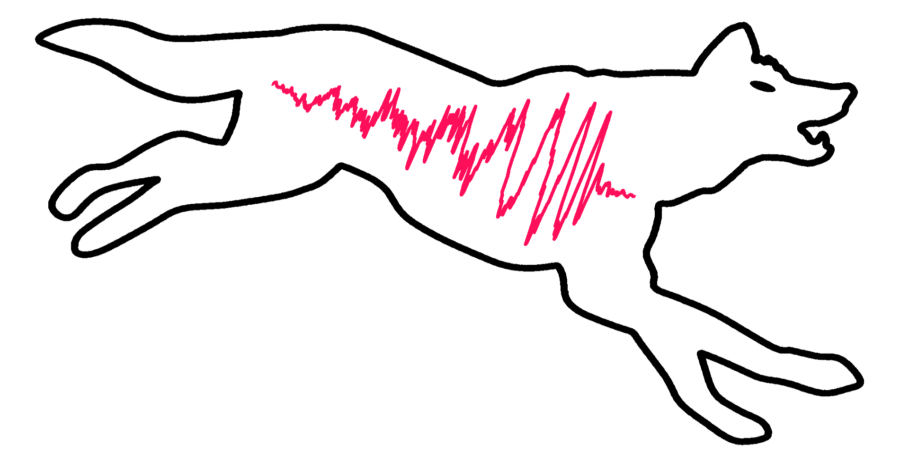
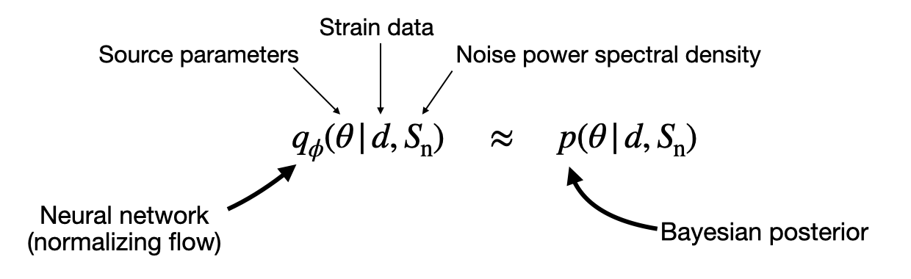
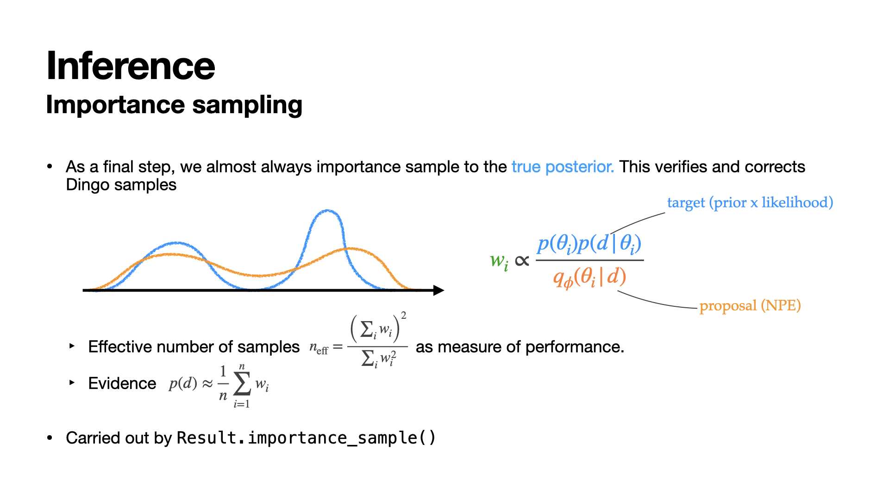
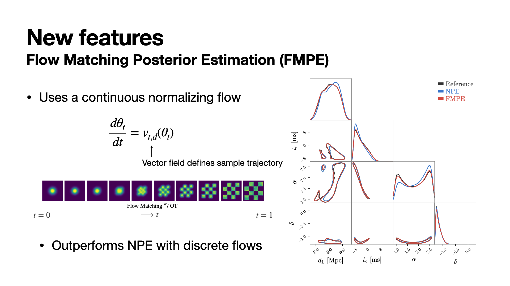
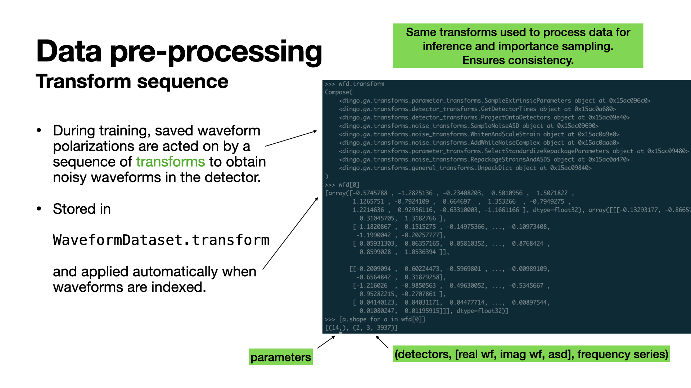
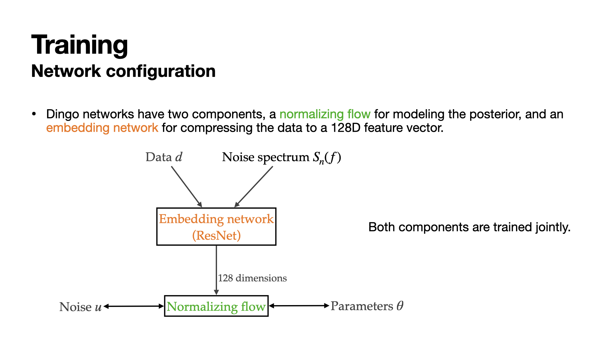

## {.title-dingo}

```{python}
#| include: false
# Code on the slides runs in the notebook's working directory, so paths match the notebook.
import os, warnings
warnings.filterwarnings("ignore")
import numpy as np
import pandas as pd
np.set_printoptions(threshold=6, edgeitems=2, precision=4, linewidth=64)
pd.set_option("display.max_rows", 6, "display.max_columns", 6, "display.precision", 3)
# Folder where the notebook was run (its outputs are read here). Only needed when re-executing;
# the rendered outputs are frozen in _freeze/.
os.chdir(os.environ.get("DINGO_TUTORIAL_RUN_DIR", "../.."))  # default: repository root
import builtins, re
_print = getattr(builtins, "_orig_print", builtins.print)  # survive kernel reuse
builtins._orig_print = _print
def _quiet_print(*args, _p=_print, _n=re.compile(
        r"^(Putting posterior model|Setting spin_conversion_phase|Loading dataset from"
        r"|Updating ASDDataset|Calculating \d+ likelihoods|Done\. This took)"), **kwargs):
    if args and isinstance(args[0], str) and _n.match(args[0]):
        return
    _p(*args, **kwargs)
builtins.print = _quiet_print
import matplotlib as mpl
import matplotlib.pyplot as plt  # activate the inline backend first; it resets rcParams
mpl.rcParams.update({
    "text.usetex": True, "font.family": "serif", "font.size": 22,
    "axes.labelsize": 26, "xtick.labelsize": 20, "ytick.labelsize": 20,
    "legend.fontsize": 21, "lines.linewidth": 2.2, "axes.linewidth": 1.2,
    "xtick.major.width": 1.2, "ytick.major.width": 1.2,
})
```

{.absolute top=90 right=70 width=700}

::: {.absolute top=430 left=100}
[[Dingo]{.sc} Tutorial]{.big-title}\
[Usage and code structure]{.big-sub}
:::

::: {.absolute bottom=80 left=100}
[Stephen Green]{.byline}\
[with Cecilia Fabbri, Matt Mould, and Lorenzo Pompili]{.coauthors}\
[CCA, Flatiron Institute — 13 November 2026]{.team}
:::

## Introduction

[Neural posterior estimation (NPE)]{.sub}

::: {.body}
- [Dingo]{.sc} uses neural posterior estimation for gravitational wave inference:
  1. Train a neural conditional density estimator to represent the posterior.

     {width=1150 style="margin: 10px 0 0 60px;"}

  2. Amortized inference: Draw samples $\theta \sim q_\phi(\theta \mid d, S_\text{n})$ for any observed $(d, S_\text{n})$.
:::

## Introduction

[References]{.sub}

::: {.body}
::: {.grid2 .even}
::: {.subheads}
- [Documentation]{.accent}
  - <https://dingo-gw.readthedocs.io/>
- [Code]{.accent}
  - <https://github.com/dingo-gw/dingo>
  - Available as `dingo-gw` package from `pip` and `conda`.
- [Community Discord server]{.accent}

  {width=190 style="margin: 4px 0 0 34px;"}\
  [discord.gg/NxzMStfWX](https://discord.gg/NxzMStfWX)
:::
::: {.subheads}
- [Leverages Bilby components]{.accent}
  - Priors, detector information, bilby_pipe automation
- [Key papers]{.accent}
  1. [arXiv:2002.07656](https://arxiv.org/abs/2002.07656): 5D toy model with normalizing flows
  2. [arXiv:2106.12594](https://arxiv.org/abs/2106.12594): Amortized inference with noise conditioning
  3. [arXiv:2210.05686](https://arxiv.org/abs/2210.05686): Importance sampling
  4. [arXiv:2305.17161](https://arxiv.org/abs/2305.17161): Flow matching
  5. [arXiv:2407.09602](https://arxiv.org/abs/2407.09602): Binary neutron stars
  6. [arXiv:2512.02968](https://arxiv.org/abs/2512.02968): Transformers ([Dingo]{.sc}-T1)
:::
:::
:::

## Introduction

[Key steps]{.sub}

::: {.body}
::: {.steps}
::: {.s1}
1. [Generate training datasets]{.green}
    a. Intrinsic waveforms (polarizations), specified by masses, spins, inclination, and phase.
    b. Noise power spectral densities, with a distribution often corresponding to an observing run.
:::
::: {.s2}
2. [Train the network]{.orange}
    a. Construct network based on specified configuration.
    b. During training, sample extrinsic parameters (sky position, distance, time of coalescence) and noise realizations, and construct simulated data.
:::
::: {.s3}
3. [Perform inference]{.sblue}
    a. For (observed or simulated) data, draw posterior samples from the trained network.
    b. Optionally importance sample to true posterior. Gives Bayesian evidence.
:::
::: {.b1}
Specified by YAML config files
:::
::: {.b2}
Use [Dingo]{.sc} API or INI file
:::
:::
:::

## Interactive tutorial

[Follow along: <https://github.com/stephengreen/dingo-tutorial>]{.sub style="font-size: 36px;"}

::: {.body}
::: {.grid2 .wide-left}
::: {}
::: {.darcula .shell}
```bash
git clone https://github.com/stephengreen/dingo-tutorial
cd dingo-tutorial
uv sync
uv run jupyter lab DINGO_Tutorial.ipynb
```
:::

::: {.compact style="margin-top: 36px;"}
- [uv](https://docs.astral.sh/uv/) installs the versions `dingo-gw` 0.10.3 was tested with, and fetches Python 3.12 if needed. Without uv: `pip` with `constraints.txt` (see README).
- Section 6 downloads the [Dingo]{.sc}-T1 model (641 MB) from Zenodo: start early.
- Notebook by Annalena Kofler, updated for `dingo-gw` 0.10.3.
:::
:::
::: {}
{width=360}
:::
:::
:::

## Generating training data

[Waveform Dataset]{.sub}

::: {.body}
::: {.grid2}
::: {}
- YAML file components:
  - Domain (f_min, f_max, etc.)
  - Waveform generator (approximant, etc.)
  - Intrinsic prior (Bilby format)
  - Size of dataset
  - Compression
- `dingo_generate_dataset` → HDF5 file.
:::
::: {.panel}
[examples/npe_model/waveform_dataset_settings.yaml]{.filetab}

::: {.darcula .sm}

:::
:::
:::
:::

## Waveform dataset

[Interactive usage]{.sub}

::: {.body}
::: {.grid2 .even}
::: {.jup .big}
```{python}
#| output: false
from dingo.gw.dataset import WaveformDataset

wfd = WaveformDataset(file_name="01_training_data/"
    "waveform_dataset/waveform_dataset.hdf5")
```

::: {.cellwrap}
[YAML config]{.tag}

```{python}
wfd.settings.keys()
```
:::

::: {.cellwrap}
[Domain object]{.tag}

```{python}
wfd.domain.f_min, wfd.domain.f_max
```
:::
:::
::: {.jup .big}
::: {.cellwrap}
[Polarizations (optionally SVD-compressed)]{.tag}

```{python}
wfd.polarizations["h_cross"].shape
```
:::

::: {.cellwrap}
[Indexing: parameters + (decompressed) waveform]{.tag}

```{python}
sample = wfd[0]
sample["waveform"]["h_plus"].shape
```
:::

```{python}
float(sample["parameters"]["chirp_mass"])
```
:::
:::
:::

## Waveform dataset

[Multi-banding]{.sub}

::: {.body}
::: {.grid2 .even}
::: {.jup}
```{python}
from dingo.gw.domains import (UniformFrequencyDomain,
                              MultibandedFrequencyDomain)
from dingo.gw.waveform_generator import WaveformGenerator

nodes = [20.0, 26.0, 34.0, 46.0, 62.0, 78.0, 1038.0]
ufd = UniformFrequencyDomain(f_min=20.0, f_max=nodes[-1],
                             delta_f=1/16)
mfd = MultibandedFrequencyDomain(nodes, delta_f_initial=1/16,
                                 base_domain=ufd)
len(ufd), len(mfd)
```

```{python}
#| output: false
p = dict(chirp_mass=30.0, mass_ratio=0.8, a_1=0.3, a_2=0.2,
         tilt_1=1.0, tilt_2=2.0, phi_12=1.0, phi_jl=0.5,
         theta_jn=1.0, phase=0.0, luminosity_distance=100.0,
         geocent_time=0.0)
wfg = WaveformGenerator("IMRPhenomXPHM", ufd, 20.0)
wf_ufd = wfg.generate_hplus_hcross(p)
wfg = WaveformGenerator("IMRPhenomXPHM", mfd, 20.0)
wf_mfd = wfg.generate_hplus_hcross(p)
```
:::
::: {}
::: {.jup}
```{python}
#| echo: false
#| fig-width: 7.4
#| fig-height: 6.6
#| fig-dpi: 110
fu, fm = ufd(), mfd()
hu, hm = 1e22 * wf_ufd["h_plus"].real, 1e22 * wf_mfd["h_plus"].real
c_u, c_m = "0.45", "tab:blue"
fig = plt.figure(figsize=(7.4, 6.6))
gs = fig.add_gridspec(2, 2, height_ratios=[1, 1.25], hspace=0.6, wspace=0.18)
ax0 = fig.add_subplot(gs[0, :])
ax0.step(fm, mfd.delta_f, where="mid", color=c_m, lw=3, label="multi-banded")
ax0.axhline(ufd.delta_f, color=c_u, lw=2.5, ls="--", label="uniform")
ax0.set_xscale("log"); ax0.set_yscale("log", base=2); ax0.set_xlim(20, 1038)
ax0.set_yticks([1/16, 1/4, 1, 2]); ax0.set_yticklabels([r"$1/16$", r"$1/4$", r"$1$", r"$2$"])
ax0.set_xlabel(r"$f$ [Hz]"); ax0.set_ylabel(r"$\Delta f$ [Hz]")
ax0.legend(frameon=False, loc="lower right")
for k, (lo, hi, ticks) in enumerate([(20.0, 21.5, [20, 20.5, 21]), (300.0, 340.0, [300, 320, 340])]):
    ax = fig.add_subplot(gs[1, k])
    mu = (fu >= lo) & (fu <= hi); mm = (fm >= lo) & (fm <= hi)
    ax.plot(fu[mu], hu[mu], ".", color=c_u, ms=3.5)
    ax.plot(fm[mm], hm[mm], "o", color=c_m, ms=8, mfc="none", mew=2.0)
    ax.set_xlim(lo, hi); ax.set_xticks(ticks); ax.set_xlabel(r"$f$ [Hz]"); ax.set_yticks([])
    ax.set_title(fr"{mu.sum()} vs.\ {mm.sum()} points", fontsize=20)
fig.axes[1].set_ylabel(r"$\mathrm{Re}\,h_+$")
```
:::
[$\Delta f$ doubles in each band: 16,609 → 736 bins. Zooms: uniform (gray) vs. multi-banded (blue) points. For a dataset: `dingo_generate_multibanded_domain`.]{.caption}
:::
:::
:::

## Generating training data

[ASD Dataset]{.sub}

::: {.body}
::: {.grid2}
::: {}
- Executed with `dingo_generate_asd_dataset`
- Downloads LVK data from GWOSC and generates PSDs using Welch method.
- Key parameters:
  - Observing run
  - Set of detectors
  - Time between PSDs / max number of PSDs
:::
::: {.panel}
[examples/npe_model/asd_dataset_settings.yaml]{.filetab}

::: {.darcula .sm}

:::
:::
:::
:::

## Training

[Overview]{.sub}

::: {.body}
::: {.grid2 .even}
::: {}
- Training carried out using `dingo_train` (or `dingo_train_condor`)
  - YAML config file specifies further [data settings]{.green}, [neural network configuration]{.orange}, [training plan]{.sblue}, and additional [local settings]{.accent} (e.g., number of cores, GPUs).
  - Produces regular checkpoint files (`.pt`), as well as training history information.
- Multi-GPU training: set `num_gpus` in local settings.
:::
::: {.panel}
[examples/npe_model/train_settings.yaml]{.filetab .s-data}

::: {.darcula .sm}

:::
:::
:::
:::

## Training

[Network configuration]{.sub}

::: {.body}
::: {.grid2}
::: {}
- Specifies architecture and size of the NN
- Currently supported: spline flows, flow matching, score matching
- Embedding network: `resnet` (first layer is initialized with SVD, computed automatically) or `transformer` ([Dingo]{.sc}-T1)
- Extension to new architectures is straightforward (requires modification of [Dingo]{.sc} code)
:::
::: {.panel}
[examples/npe_model/train_settings.yaml]{.filetab .s-model}

::: {.darcula .sm}

:::
:::
:::
:::

## Training

[Training plan]{.sub}

::: {.body}
::: {.grid2}
::: {}
- Specifies training configuration (epochs, batch size, optimizer, learning rate schedule)
- Training stages
  - **Stage 0**: use fixed ASD per detector.
  - **Stage 1**: use multiple ASDs per detector.\
    → ASDs could cover an entire observing run\
    → Learning rate should be reduced (~0.1x)
- Training stages may also be used without changing the ASD dataset
:::
::: {.panel}
[examples/npe_model/train_settings.yaml]{.filetab .s-training}

::: {.darcula .sm}

:::
:::
:::
:::

## Inference

[Overview]{.sub}

::: {.body .center .large}
- Trained networks for common configurations are on Zenodo (e.g., [Dingo]{.sc}-T1 for O3).
- Two options for inference:
  - **Sampler API** — useful for injections, experiments
  - **dingo_pipe** — based on bilby_pipe
- After inference, typically importance sample to true posterior (default in dingo_pipe).
:::

## Inference

[Sampler API]{.sub}

::: {.body}
::: {.grid2 .wide-left}
::: {.jup}
```{python}
from dingo.core.posterior_models import build_model_from_kwargs
from dingo.gw.inference.sampler import GWComposedSampler
from dingo.gw.injection import Injection
from dingo.gw.noise.asd_dataset import ASDDataset

model = build_model_from_kwargs(filename="02_training/model_latest.pt",
                                device="cpu", load_training_info=False)
injection = Injection.from_posterior_model_metadata(model.metadata)
injection.asd = ASDDataset("01_training_data/asd_dataset/asd_GW150914.hdf5",
                           ifos=["H1", "L1"])
theta = injection.prior.sample()  # Random injection from prior.
strain_data = injection.injection(theta)  # dict

sampler = GWComposedSampler.from_model(model, strain_data)
sampler.run_sampler(num_samples=10_000, batch_size=5_000)
sampler.samples
```
:::
::: {.compact}
1. Load model with `build_model_from_kwargs`
2. Prepare injection; the data are a dict with `waveform`, `asds`, and `parameters`
3. Build `GWComposedSampler` from model and data
4. Execute `run_sampler()`
:::
:::
:::

## Inference

[Result class]{.sub}

::: {.body}
::: {.grid2 .even}
::: {.compact}
- Contains functionality for post-processing [Dingo]{.sc} samples:
  - Saving / loading
  - Plotting
  - Importance sampling / calculating evidence
  - Generating synthetic phase (and polarization angle), i.e., reconstructing it from the likelihood
  - Rejection sampling (unweighted samples)
  - Training new flows based on samples
- [Stores all precursor settings (e.g., network settings, training, and event data).]{.accent}
:::
::: {.jup}
```{python}
#| output: false
from dingo.gw.result import Result

path = "05_pretrained_model/GW190701_203306/H1_L1/result/"
result = Result(file_name=path + "GW190701_203306_data0_"
                "1246048404-56_importance_sampling.hdf5")
```

::: {.cellwrap}
[Importance sampling]{.tag}

```{python}
result.print_summary()
```
:::

```{python}
result.samples[["chirp_mass", "log_prob", "weights"]]
```
:::
:::
:::

## Inference {visibility="hidden"}

{.absolute top=0 left=0 width=1920 height=1080}

## Inference

[`dingo_pipe`]{.sub}

::: {.body}
::: {.grid2 .text-heavy}
::: {.compact}
- Automates inference tasks, including downloading of GW data. Specified by INI file:
  - **Job submission**
  - **Sampler:** specify [Dingo]{.sc} models, number of samples, GNPE iterations (Gibbs sampling over detector time shifts), data/prior updates for importance sampling, …
  - **Data generation:** specify GPS time, point to frame files (or gwosc), point to PSDs. [Dingo]{.sc}-T1: choose detectors, frequency range, PSD notches.
  - Optional: **injections**, **calibration marginalization** (with importance sampling), **corner and diagnostic plots**
- Importance sampling (incl. synthetic phase) runs by default.
- Saves a Result HDF5 file in the end, which can also be read by PESummary.
:::
::: {}
[Most settings (detectors, etc.) are taken from the [Dingo]{.sc} model.]{.tag}

::: {.panel}
[examples/npe_model/GW150914.ini]{.filetab}

::: {.darcula .sm}

:::
:::
:::
:::
:::

## New features {visibility="hidden"}

{.absolute top=0 left=0 width=1920 height=1080}

## Recent developments

[Sampling chains: `GWComposedSampler`]{.sub}

::: {.body}
::: {.grid2 .even}
::: {.compact}
- The posterior is an ordered product of conditionals,
  $$q(\theta \mid d) = \prod_i q_i(\theta_i \mid \theta_{<i}, d)$$
- Each **step** adds parameter columns and a term to $\log\,q$: a flow, a point mass (fixed parameters), a change of variables (sky rotation), the synthetic phase, …
- Chains are assembled from the model metadata (`from_model`, `from_gnpe_models`), or by hand.
- $\log\,q$ is tracked through every step, so the result can be importance sampled directly. (A Gibbs block has no density; GNPE needs density recovery first.)
:::
::: {}
[Plain NPE]{.chain-label}

::: {.chain}
[`FlowFactor` network]{.step}[→]{.arrow}[`RAToEventFrame` sky rotation]{.step .reparam}
:::

[Synthetic phase, before importance sampling]{.chain-label}

::: {.chain}
[`SampleTableFactor` existing samples]{.step}[→]{.arrow}[`SyntheticPhaseFactor` from likelihood]{.step .is}
:::

[GNPE]{.chain-label}

::: {.chain}
[`GibbsBlock` init network, then kernel ⇄ flow ×N]{.step .gibbs}[→]{.arrow}[`RAToEventFrame`]{.step .reparam}
:::

[Binary neutron stars (prior conditioning)]{.chain-label}

::: {.chain .tight4}
[`DeltaFactor` pin proxy]{.step}[→]{.arrow}[`FlowFactor` network]{.step}[→]{.arrow}[`ProxyOffsetReparam` $\mathcal{M} = \tilde{\mathcal{M}} + \delta\mathcal{M}$]{.step .reparam}[→]{.arrow}[`RAToEventFrame`]{.step .reparam}
:::

::: {.legend}
[]{.k style="background:#dbe9f6;border-color:#2980b9"}factor [ ]{.k style="background:#e2f0e6;border-color:#27ae60"}change of variables [ ]{.k style="background:#efe3f6;border-color:#8e44ad"}uses likelihood [ ]{.k style="background:#fbe7d6;border-color:#e2792e"}Gibbs (no density)
:::
:::
:::
:::

## Recent developments

[Variable frequency ranges]{.sub}

::: {.body}
::: {.grid2 .even}
::: {.compact}
- **Training** with `random_strain_cropping`: waveform and ASD are masked outside a random frequency range, per detector. $f_\text{min}$ is raised up to `f_min_upper`; $f_\text{max}$ is lowered down to `f_max_lower`.
- **Inference**: set `minimum-frequency` / `maximum-frequency` in the INI file (a float, or per detector). Checked against the training range.
- The likelihood range for importance sampling can be set separately (`importance-sampling-updates`), even beyond the network band.
- [Dingo]{.sc}-T1 does the same by masking tokens (next slides).
:::
::: {}
::: {.panel}
[examples/npe_model/train_settings.yaml [(commented out)]{.note}]{.filetab .s-data}

::: {.darcula .sm}

:::
:::

::: {.panel style="margin-top: 36px;"}
[event.ini [(illustration)]{.note}]{.filetab}

::: {.darcula .sm}

:::
:::
:::
:::
:::

## Recent developments

[[Dingo]{.sc}-T1: transformer model]{.sub}

::: {.body}
::: {.grid2 .even}
::: {.compact}
- Data in each detector are split into **tokens** (16 frequency bins) and processed by a transformer encoder.
- Trained with random masking of detectors, frequency ranges, and narrow bands.
- A single network analyzes any subset of H1, L1, V1, with per-detector frequency ranges and PSD notches, **without retraining**.
- Trained for O3 (IMRPhenomXPHM); available on Zenodo.
- Kofler et al., [arXiv:2512.02968](https://arxiv.org/abs/2512.02968)
:::
::: {}
```{python}
#| echo: false
#| fig-width: 7.6
#| fig-height: 6.6
#| fig-dpi: 110
import glob
import matplotlib.pyplot as plt
from scipy.stats import gaussian_kde

res = {d: Result(file_name=glob.glob(f"05_pretrained_model/GW190701_203306/{d}/result/"
                                     "*importance_sampling.hdf5")[0]).samples for d in ["H1", "H1_L1"]}
params = [("chirp_mass", r"$\mathcal{M}_c\ [M_\odot]$", 1.0), ("mass_ratio", r"$q$", 1.0),
          ("luminosity_distance", r"$d_L\ [\mathrm{Gpc}]$", 1e-3), ("dec", r"$\delta\ [\mathrm{rad}]$", 1.0)]
style = {"H1": dict(color="tab:orange", label=r"$\mathrm{H1}$", fill=False),
         "H1_L1": dict(color="tab:blue", label=r"$\mathrm{H1} + \mathrm{L1}$", fill=True)}

def wquantile(x, w, q):
    i = np.argsort(x); c = np.cumsum(w[i]); c /= c[-1]
    return np.interp(q, c, x[i])

fig, axes = plt.subplots(2, 2, figsize=(7.6, 6.6))
for ax, (p, lab, scale) in zip(axes.flat, params):
    lo = min(wquantile(s[p].to_numpy() * scale, s["weights"].to_numpy(), 0.005) for s in res.values())
    hi = max(wquantile(s[p].to_numpy() * scale, s["weights"].to_numpy(), 0.995) for s in res.values())
    if p == "mass_ratio":
        hi = min(hi, 1.0)
    grid = np.linspace(lo, hi, 400)
    for d, s in res.items():
        kde = gaussian_kde(s[p].to_numpy() * scale, weights=s["weights"].to_numpy())
        y = kde(grid) + (kde(2.0 - grid) if p == "mass_ratio" else 0)  # reflect at q = 1
        st = style[d]
        if st["fill"]:
            ax.fill_between(grid, y, alpha=0.22, color=st["color"], lw=0)
        ax.plot(grid, y, lw=3, color=st["color"], label=st["label"])
    ax.set_xlabel(lab, fontsize=26); ax.tick_params(labelsize=21)
    ax.set_yticks([]); ax.set_ylim(bottom=0); ax.set_xlim(lo, hi); ax.grid(False)
    for side in ["left", "right", "top"]:
        ax.spines[side].set_visible(False)
    ax.locator_params(axis="x", nbins=4)
handles, labels_ = axes[0, 0].get_legend_handles_labels()
fig.legend(handles, labels_, loc="upper center", ncol=2, frameon=False, fontsize=24,
           handlelength=1.6, columnspacing=2.0, bbox_to_anchor=(0.5, 1.0))
fig.tight_layout(rect=(0, 0, 1, 0.92), h_pad=1.8, w_pad=1.8)
```
[GW190701_203306, analyzed by the same network with H1 only and with H1 + L1 (importance-weighted posteriors).]{.caption}
:::
:::
:::

## Recent developments

[[Dingo]{.sc}-T1: configuration]{.sub}

::: {.body}
::: {.grid2 .even}
::: {}
::: {.compact}
- **Training**: `embedding_type: transformer` and a `tokenization` block in the data settings, which sets the masking during training.
- **Inference**: per event, in the INI file. Ranges must lie within those seen in training.
:::

::: {.panel style="margin-top: 40px;"}
[examples/dingo_t1/GW150914.ini [(excerpt)]{.note}]{.filetab}

::: {.darcula .sm}

:::
:::
:::
::: {.panel}
[examples/dingo_t1/train_settings.yaml]{.filetab .s-data}

::: {.darcula .sm}

:::
:::
:::
:::

## Recent developments

[Binary neutron stars]{.sub}

::: {.body}
::: {.grid2 .even}
::: {.compact}
- Long inspirals → fine frequency resolution, large data. Chirp mass $\mathcal{M}$ is measured very precisely.
- A chirp-mass **proxy** $\tilde{\mathcal{M}}$ does two jobs:
  - **Heterodyning**: remove the leading-order chirp phase $\phi(f;\tilde{\mathcal{M}})$ from the data → aggressive multibanding.
  - **Prior conditioning**: the network learns $q(\theta \mid d, \tilde{\mathcal{M}})$ for narrow priors around $\tilde{\mathcal{M}}$, and infers $\delta\mathcal{M} = \mathcal{M} - \tilde{\mathcal{M}}$.
- $\tilde{\mathcal{M}}$ is set per event: from a search trigger, or by a **chirp-mass scan** of the data. Then one network pass, with density → importance sampling.
- Dax et al., [arXiv:2407.09602](https://arxiv.org/abs/2407.09602); worked example in the docs.
:::
::: {}
::: {.panel}
[examples/binary_neutron_stars/train_settings.yaml]{.filetab .s-data}

::: {.darcula .sm}

:::
:::

::: {.panel style="margin-top: 28px;"}
[examples/binary_neutron_stars/GW170817.ini [(excerpt)]{.note}]{.filetab}

::: {.darcula .sm}

:::
:::

::: {.procedure}
[Chirp-mass scan (`chirp-mass-scan = true`)]{.head}

1. Sweep $\tilde{\mathcal{M}}$ over the training prior, on a grid set by the kernel width.
2. Draw a few samples per grid point (batched network passes).
3. Evaluate a phase-marginalized likelihood; the max-likelihood $\mathcal{M}$ is the trigger.

About a minute of CPU time for a GW170817-like event.
:::
:::
:::
:::

## Recent developments

[Multi-GPU training]{.sub}

::: {.body}
::: {.grid2}
::: {}
- Distributed data parallel (DDP) training: set `num_gpus` in local settings.
- `batch_size` and `num_workers` are totals, split across GPUs.
- Requires `freeze_rb_layer: False` (the SVD-initialized first layer is trained) in all stages; `norm: LayerNorm` is recommended.
- Optional `torch_compile` for the flow network.
:::
::: {.panel}
[examples/dingo_t1/train_settings.yaml]{.filetab .s-local}

::: {.darcula .sm}

:::
:::
:::
:::

## Recent developments

[Further additions]{.sub}

::: {.body .center .large}
- **Importance sampling**: synthetic $(\phi_c, \psi)$, calibration sampled in the same chain, cached likelihoods, rejection sampling.
- **dingo_pipe**: injections, reproducible sampling seeds.
- **Waveforms and detectors**: tidal models (NRTidal), SEOBNRv5PHM antisymmetric modes, triangular detectors.
:::

## Interactive tutorial

[<https://github.com/stephengreen/dingo-tutorial>]{.sub style="font-size: 38px;"}

::: {.body}
::: {.grid2 .wide-left}
::: {}
| Notebook section | Key step |
|:--|:--|
| 1. Waveform dataset | [Generate training datasets]{.green} |
| 2. Noise (ASD) dataset | [Generate training datasets]{.green} |
| 3. Training a toy model | [Train the network]{.orange} |
| 4. Injections (Sampler API) | [Perform inference]{.sblue} |
| 5. GW150914 with `dingo_pipe` | [Perform inference]{.sblue} |
| 6. GW190701 with [Dingo]{.sc}-T1 (H1 vs. H1 + L1) | [Perform inference]{.sblue} |

: {.notebook-map}

Notebook by Annalena Kofler, updated for `dingo-gw` 0.10.3. The full run takes ~25 min on a laptop CPU.
:::
::: {}
{width=400 style="margin-top: 20px;"}
:::
:::
:::

## Extra Slides {visibility="hidden"}

::: {.absolute top=440 left=100 .big-title}
Extra Slides
:::

## Training {visibility="hidden"}

[Data settings]{.sub}

::: {.body}
::: {.grid2}
::: {}
- Points to the waveform dataset
- Specifies settings needed to generate simulated strain data:
  - data conditioning settings
  - detector configuration
  - extrinsic prior
  - reference time ([Dingo]{.sc} holds the Earth fixed)
- Also takes list of inference parameters. By omitting parameters that are in the prior, [Dingo]{.sc} marginalizes over them.
:::
::: {.panel}
[examples/npe_model/train_settings.yaml]{.filetab .s-data}

::: {.darcula .sm}

:::
:::
:::
:::

## Data pre-processing {visibility="hidden"}

{.absolute top=0 left=0 width=1920 height=1080}

## Training {visibility="hidden"}

{.absolute top=0 left=0 width=1920 height=1080}

## Training {visibility="hidden"}

[Local settings]{.sub}

::: {.body}
::: {.grid2}
::: {}
- Infrastructure settings (don't affect final model).
- Big models require a GPU, but CPU training is supported for prototyping
- Full GPU utilization requires sufficient workers for preprocessing.
- Multi-GPU training with `num_gpus`.
- Optional external logging with Weights & Biases
- `runtime_limits` and `condor` are cluster-specific.
:::
::: {.panel}
[examples/npe_model/train_settings.yaml]{.filetab .s-local}

::: {.darcula .sm}

:::
:::
:::
:::
